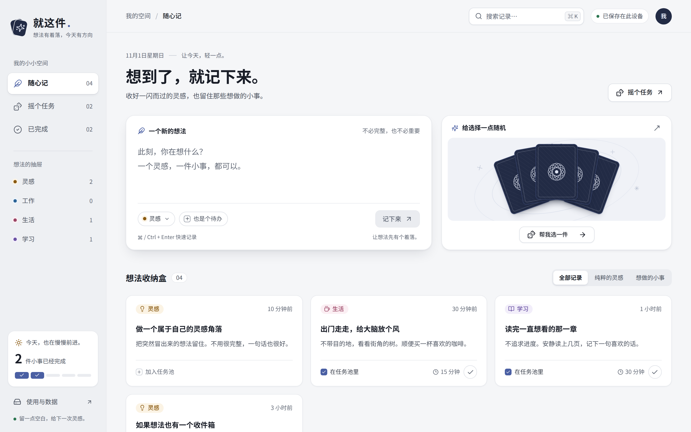
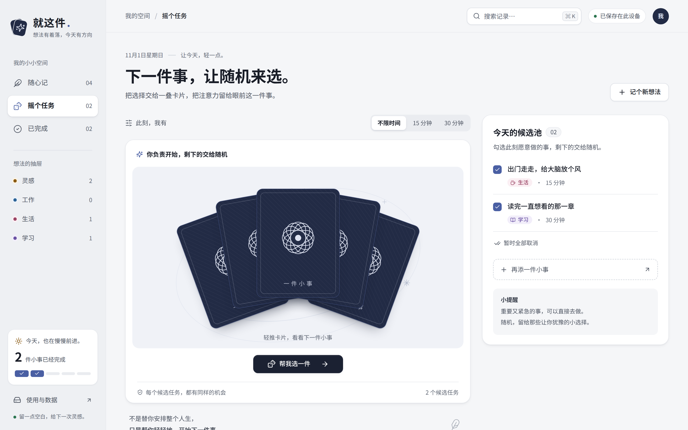
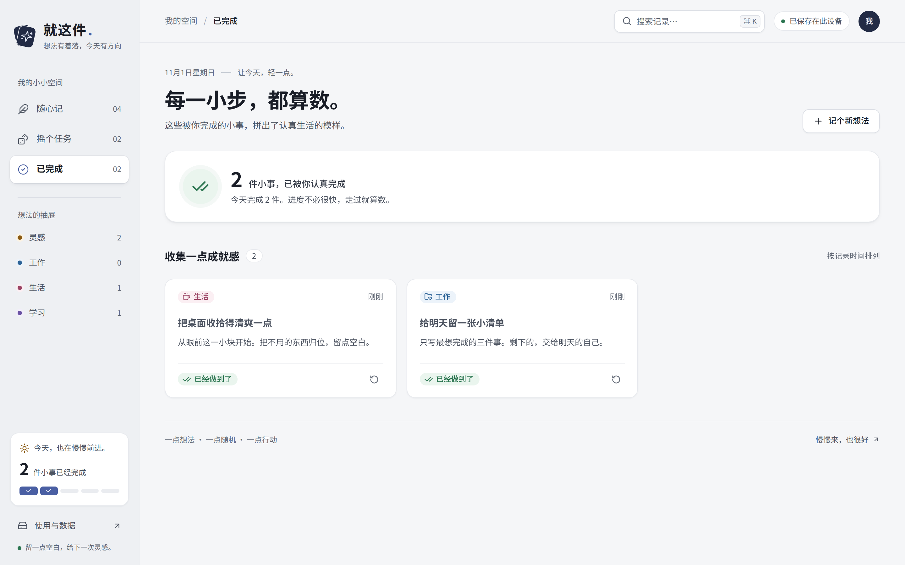
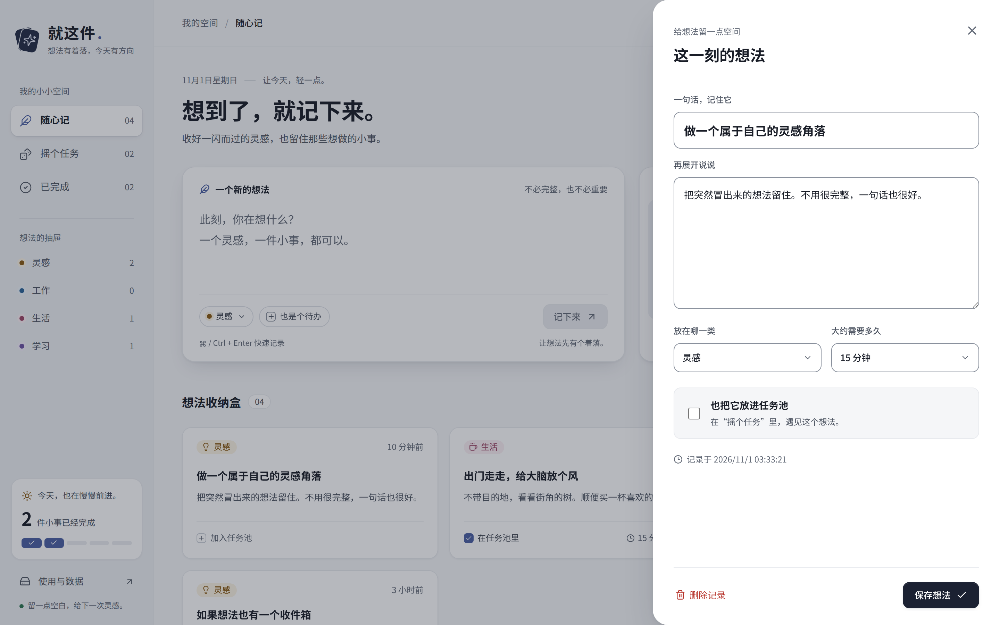

# 就这件 · Just This One

就这件是面向个人的轻量想法与任务工具，适合想法多、待办杂、常常不知道先做哪件的人。随手记下一闪而过的念头和想做的小事；犹豫的时候，把勾选的候选交给一叠卡片随机抽出一件，专注做完再归档。记录只保存在当前浏览器，不需要账号，也不依赖后端服务。

项目专注于“记下来”和“开始做”，不提供截止日期、提醒、优先级排序、多人协作或跨设备同步，也不打算发展成项目管理工具。重要又紧急的事建议直接去做，随机抽取留给那些让人犹豫的小选择。

## 适合谁

- 想法来得快、忘得也快，需要一个随手就能记下、不必先整理的地方。
- 清单里攒了不少小事，面对一长串反而迟迟开不了头。
- 空出一段时间时，想按“现在有 15 分钟”挑一件刚好做得完的事。
- 希望工具简单安静，数据只留在自己的设备上，不想注册账号。

## 界面预览

截图使用首次打开时自带的示例记录。



### 摇个任务

勾选候选任务，轻推卡片或点“帮我选一件”，洗牌后翻开一张。接受后进入专注状态，完成或放回任务池。



| 抽到一件 | 开始专注 |
| --- | --- |
|  |  |

### 已完成与编辑

| 已完成 | 编辑记录 |
| --- | --- |
|  |  |

### 手机端

| 随心记 | 摇个任务 | 抽中结果 |
| --- | --- | --- |
|  |  |  |

## 功能

- 随心记：支持多行记录、分类、预计耗时、加入任务池、搜索、编辑和撤销删除。
- 摇个任务：点击或拖动卡片触发洗牌，以等概率从勾选的任务中选取；可筛选预计耗时。候选多于一个时，换一件避免立即抽到上一个结果。
- 专注与归档：接受抽取结果后可以完成，或先放回任务池；完成的任务在“已完成”中查看，也可以恢复。
- 数据：自动保存在当前浏览器的 localStorage，支持 JSON 备份导出、合并导入及清空示例。
- 快捷键：N 快速记录，⌘/Ctrl K 搜索，⌘/Ctrl Enter 保存。
- 无障碍：原生对话框管理焦点，支持键盘操作、屏幕阅读器提示与系统“减少动态效果”。

首次打开带有明确说明的示例记录，可在“使用与数据”中清空。不要使用浏览器隐私模式保存需要长期保留的记录，定期导出备份。

## 本地运行

```bash
npm install
npm run dev
```

```bash
npm run build
npm run preview
```

技术：React、TypeScript、Vite、Lucide 图标；动效使用 CSS、Pointer Events 和浏览器 View Transitions，无动画运行库。
